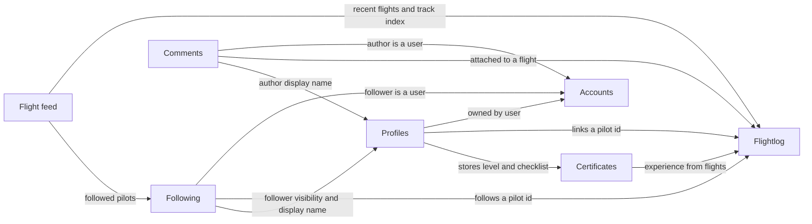

# Bounded contexts

## Code

| Element | Path |
|---|---|
| Flightlog | src/lib/flightlog |
| Accounts | src/lib/auth, src/lib/db/auth-schema.ts |
| Profiles | src/lib/profiles, src/features/account, src/lib/db/domain-schema.ts, drizzle/0002_domain_functions.sql |
| Certificates | src/lib/certificates |
| Following | src/lib/follows, src/components/follow-button |
| Comments | src/lib/comments, src/features/comment-on-flight |
| Flight feed | src/features/browse-flight-feed, src/lib/watermark-store, src/lib/seen-trip-store |
