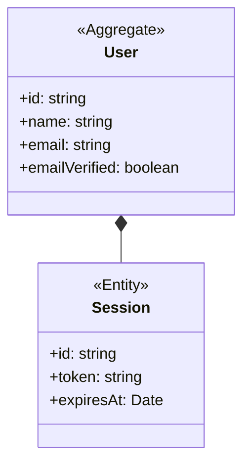

# Accounts

## Invariants

- User: deleting a user cascades to their sessions, accounts, profile, verifications, follows and comments (src/lib/db/domain-schema.ts:22, src/lib/db/auth-schema.ts).
- User: a magic link signs in once; a second use is rejected (library-enforced, pinned by src/lib/auth/magic-link.test.ts:87).
- User: sign-out ends only the session the request carries (src/lib/auth/magic-link.test.ts:99), and the sign-out request must be same-origin (src/app/api/auth/sign-out/route.ts:10).
- User: the session cookie is Secure and HttpOnly under an https public origin (src/lib/auth/server.ts:26).

## Code

| Element | Path |
|---|---|
| User | src/lib/db/auth-schema.ts, src/lib/auth/current-user.ts |
| Session | src/lib/db/auth-schema.ts, src/lib/auth/use-signed-in-user.ts |
