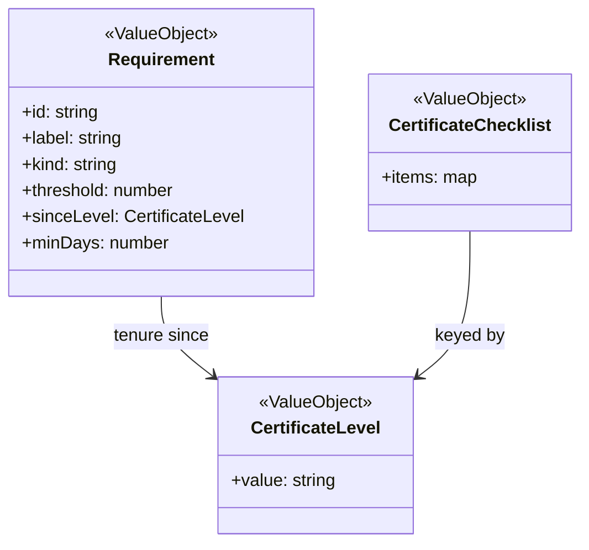

# Certificates

The syllabus is static and evaluation is pure; a pilot's own level and checklist are stored on their Profile.

## Code

| Element | Path |
|---|---|
| CertificateLevel | src/lib/certificates/types.ts |
| Requirement | src/lib/certificates/types.ts, src/lib/certificates/requirements.ts, src/lib/certificates/evaluate-requirements.ts, src/lib/certificates/experience.ts |
| CertificateChecklist | src/lib/certificates/types.ts |
