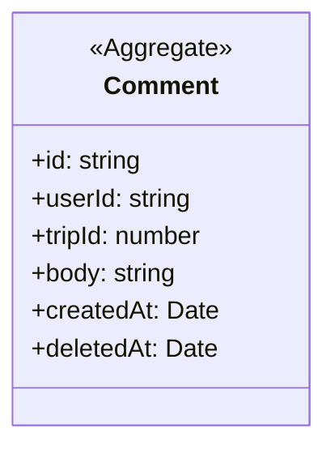

# Comments

## Invariants

- Comment: a blank body is refused and the body is trimmed (src/lib/comments/post-comment.ts:25, src/lib/comments/post-comment.ts:35).
- Comment: 5 or more comments by a user in the trailing minute refuse the next, deleted ones included, and a failed check refuses too (src/lib/comments/post-comment.ts:32, src/lib/comments/post-comment.ts:48, src/lib/comments/post-comment.ts:31).
- Comment: the author is always the session user (src/lib/comments/post-comment.ts:22).
- Comment: only the author deletes, softly and once; anything else reads as not found (src/lib/comments/delete-comment.ts:15, src/lib/db/domain-functions.test.ts:150).
- Comment: deleted comments are hidden from every reader, author included (src/lib/comments/get-comments.ts:32).
- Comment: soft delete is the only write after insert (source scan in src/lib/comments/no-comment-updates.test.ts:20).

## Code

| Element | Path |
|---|---|
| Comment | src/lib/db/domain-schema.ts, src/lib/comments/types.ts, src/lib/comments/post-comment.ts, src/lib/comments/delete-comment.ts, src/lib/comments/get-comments.ts, src/lib/comments/get-comments-for-trip-ids.ts, drizzle/0002_domain_functions.sql |
