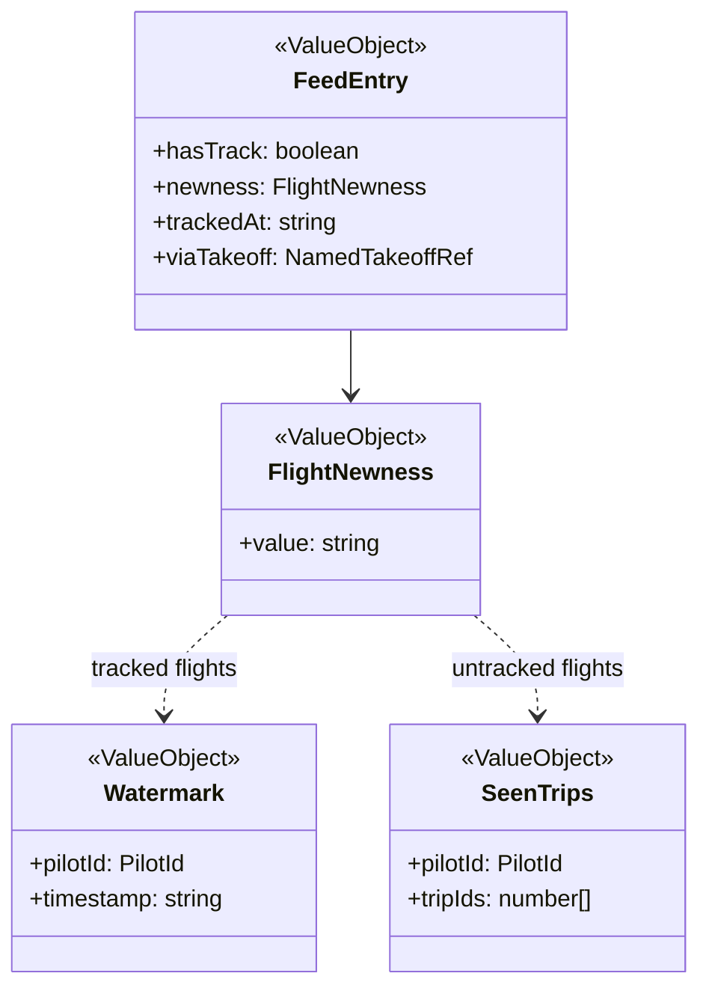

# Flight feed

Seen state lives in the viewer's browser storage; the feed is rebuilt on every load.

Sources: each followed pilot's recent flights, and each followed takeoff's recent flights (`/api/countries/[countryId]/takeoffs/[takeoffId]/recent-flights`). Both are capped (`MAX_PILOTS_PER_FEED`, `MAX_TAKEOFFS_PER_FEED`) and merged newest first. A trip in more than one source appears once, deduped by trip id before the cut to `FEED_SIZE`: the pilot-sourced entry wins, then the first takeoff by ascending country and takeoff id. A site-sourced entry carries `viaTakeoff` (rendered as "via <takeoff>"), is never new, and writes no watermark or seen-trip state, since its pilot may not be followed.

## Code

| Element | Path |
|---|---|
| FeedEntry | src/features/browse-flight-feed/feed.ts |
| FlightNewness | `classifyTrackedNewness` and `classifyUntrackedNewness` in src/features/browse-flight-feed/feed.ts |
| Watermark | src/lib/watermark-store/watermark-ids.ts, src/lib/watermark-store/storage.ts |
| SeenTrips | src/lib/seen-trip-store/seen-trip-ids.ts, src/lib/seen-trip-store/storage.ts |
