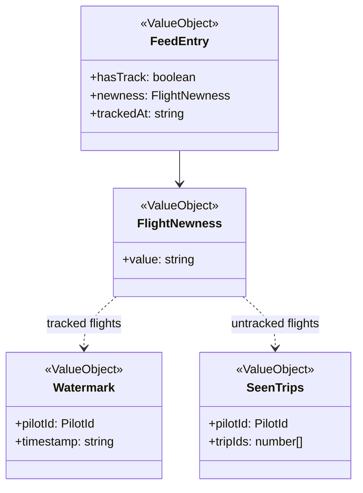

# Flight feed

Seen state lives in the viewer's browser storage; the feed is rebuilt on every load.

## Code

| Element | Path |
|---|---|
| FeedEntry | src/features/browse-flight-feed/feed.ts |
| FlightNewness | src/features/browse-flight-feed/feed.ts:167, src/features/browse-flight-feed/feed.ts:179 |
| Watermark | src/lib/watermark-store/watermark-ids.ts, src/lib/watermark-store/storage.ts |
| SeenTrips | src/lib/seen-trip-store/seen-trip-ids.ts, src/lib/seen-trip-store/storage.ts |
