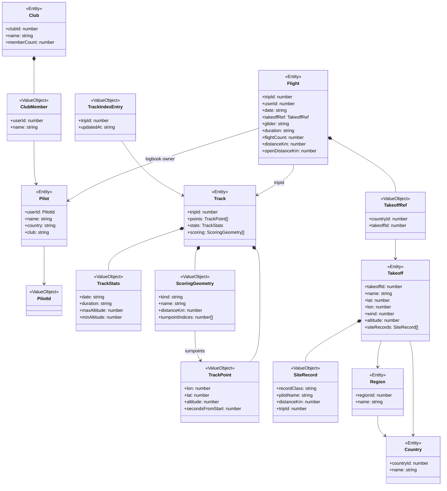

# Flightlog

External system. Everything here is read from flightlog.org and never written, so no type is a consistency root that commands target.

## Code

| Element | Path |
|---|---|
| Pilot | src/lib/flightlog/types.ts, src/lib/flightlog/is-fallback-pilot.ts |
| PilotId | src/lib/flightlog/types.ts:18 |
| Flight | src/lib/flightlog/types.ts (Flight, FlightDetail, TakeoffFlight), src/lib/flightlog/flight-aggregates.ts |
| TakeoffRef | src/lib/flightlog/types.ts |
| Track | src/lib/flightlog/types.ts, src/lib/flightlog/parse-track.ts |
| TrackPoint | src/lib/flightlog/types.ts |
| TrackStats | src/lib/flightlog/types.ts |
| ScoringGeometry | src/lib/flightlog/types.ts, src/lib/flightlog/parse-track.ts:286 |
| TrackIndexEntry | src/lib/flightlog/types.ts, src/app/api/pilots/[userId]/recent-flights/contract.ts |
| Takeoff | src/lib/flightlog/types.ts (Takeoff, TakeoffDetail), src/lib/flightlog/wind.ts, src/lib/flightlog/has-known-location.ts, src/app/api/countries/[countryId]/takeoffs/contract.ts |
| SiteRecord | src/lib/flightlog/types.ts |
| Country | src/lib/flightlog/types.ts, src/lib/flightlog/curated-countries.ts |
| Region | src/lib/flightlog/types.ts |
| Club | src/lib/flightlog/types.ts (Club, ClubDetail) |
| ClubMember | src/lib/flightlog/types.ts, src/lib/flightlog/parse-club-roster.ts |
