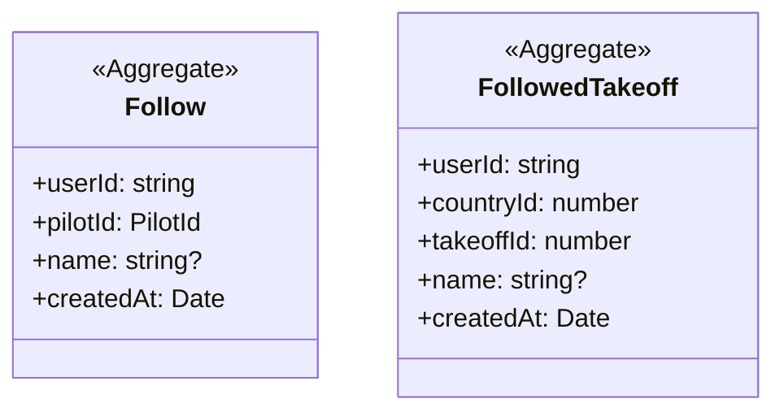

# Following

## Invariants

- Follow: a user follows a pilot at most once (composite key, src/lib/db/domain-schema.ts:54); following again succeeds (src/lib/follows/follow-pilot.ts:20).
- Follow: unfollow removes only the row of the session user and that pilot (src/lib/follows/unfollow-pilot.ts:18).
- Follow: the follower is the session user, enforced by the callers, not by the follow functions (src/components/follow-button/actions.ts:33, src/lib/follows/follow-pilot.ts:18).
- Follow: a pilot's followers are visible only to a viewer whose profile links that pilot id (src/lib/follows/get-followers-for-pilot.ts:23).
- Follow: a failed query throws instead of reading as no follows (src/lib/follows/get-followed-pilot-ids.ts:28).
- FollowedTakeoff: a user follows a takeoff, keyed by country and takeoff id (flightlog.org numbers takeoffs per country), at most once; following again succeeds, and unfollow removes only the session user's row (`followedTakeoffs` in src/lib/db/domain-schema.ts, `followTakeoff` and `unfollowTakeoff`).
- FollowedTakeoff: the follower is the session user, enforced by `followTakeoffAction` and `unfollowTakeoffAction`, not by the lib functions.
- FollowedTakeoff: a failed query throws instead of reading as no followed takeoffs (`getFollowedTakeoffs`); the viewer follow state then reads as follows-unavailable.
- FollowedTakeoff: the country takeoff list stays prerendered, so it reads the viewer's followed takeoffs client-side after mount, once per list, from `GET /api/follows/takeoffs`; rows show a follow button only once that read answers signed in, and none while it is loading, signed out or failed.
- Follow, FollowedTakeoff: the name is looked up server-side by the follow action (never taken from the client) and stored on the row; a lookup that fails, finds nothing or exceeds 3 seconds stores null and the follow still succeeds (`lookupPilotName` and `lookupTakeoffName` in src/components/follow-button/lookup-follow-name.ts). A re-follow never rewrites the name, so a null name stays null until the backfill script (scripts/backfill-follow-names.mts) fills it; it only updates rows whose name is null.
- Follow, FollowedTakeoff: the /following page lists each kind newest follow first and shows the stored name, falling back to a render-time lookup and then to the id for a null name; it never writes the name and offers no unfollow. A failed list query shows a load-failed line for that section, never the empty state (`getFollowedPilots`, `getFollowedTakeoffRows`).
- FollowedTakeoff: unfollowing clears no watermark or seen-trip state, which is pilot-keyed.

## Code

| Element | Path |
|---|---|
| Follow | src/lib/db/domain-schema.ts, src/lib/follows/follow-pilot.ts, src/lib/follows/unfollow-pilot.ts, src/lib/follows/get-followers-for-pilot.ts, src/lib/follows/get-followed-pilot-ids.ts, src/lib/follows/get-followed-pilots.ts, src/features/following/index.tsx, src/components/follow-button/lookup-follow-name.ts, src/lib/follows/backfill-follow-names.ts |
| FollowedTakeoff | src/lib/db/domain-schema.ts, src/lib/follows/follow-takeoff.ts, src/lib/follows/unfollow-takeoff.ts, src/lib/follows/get-followed-takeoffs.ts, src/lib/follows/get-followed-takeoff-rows.ts, src/app/api/follows/takeoffs/route.ts, src/components/follow-button/takeoff-follow-button.tsx |
