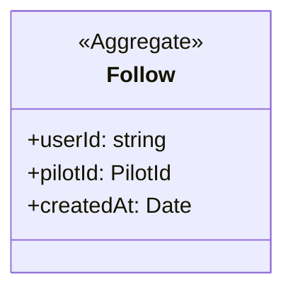

# Following

## Invariants

- Follow: a user follows a pilot at most once (composite key, src/lib/db/domain-schema.ts:53); following again succeeds (src/lib/follows/follow-pilot.ts:17).
- Follow: unfollow removes only the row of the session user and that pilot (src/lib/follows/unfollow-pilot.ts:18).
- Follow: the follower is the session user, enforced by the callers, not by the follow functions (src/components/follow-button/actions.ts:26, src/lib/follows/follow-pilot.ts:12).
- Follow: a pilot's followers are visible only to a viewer whose profile links that pilot id (src/lib/follows/get-followers-for-pilot.ts:23).
- Follow: a failed query throws instead of reading as no follows (src/lib/follows/get-followed-pilot-ids.ts:28).

## Code

| Element | Path |
|---|---|
| Follow | src/lib/db/domain-schema.ts, src/lib/follows/follow-pilot.ts, src/lib/follows/unfollow-pilot.ts, src/lib/follows/get-followers-for-pilot.ts, src/lib/follows/get-followed-pilot-ids.ts |
