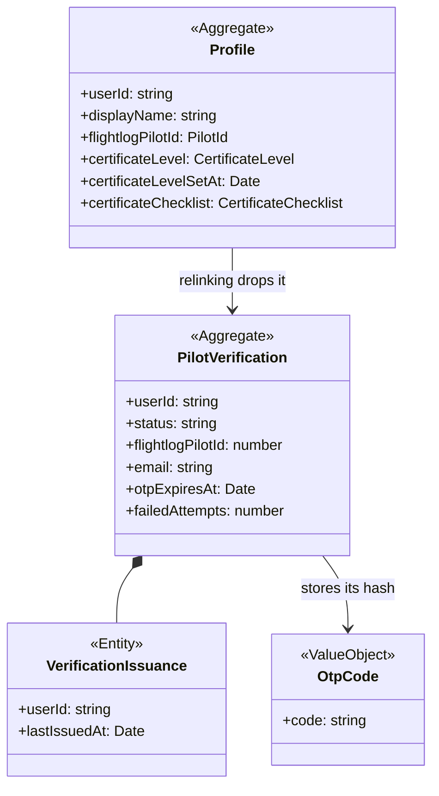

# Profiles

## Invariants

- Profile: one profile per user (src/lib/db/domain-schema.ts:61); a missing row reads as the empty profile (src/lib/profiles/get-profile.ts:23).
- Profile: writes are keyed on the session user, never a user id from the form (src/lib/profiles/update-flightlog-pilot-id.ts:29, src/features/account/actions.ts:36).
- Profile: a blank display name is stored as null (src/lib/profiles/update-display-name.ts:18).
- Profile: a pilot id must be well formed (src/features/account/actions.ts:48) and exist on flightlog.org before it is linked (src/lib/profiles/update-flightlog-pilot-id.ts:25).
- Profile: changing the linked pilot id deletes its verification (trigger in drizzle/0002_domain_functions.sql, pinned by src/lib/db/domain-functions.test.ts:181).
- Profile: certificate level is one of PP2 to PP5 (check constraint, src/lib/db/domain-schema.ts:69), and every save re-stamps when it was set (src/lib/profiles/update-certificate-level.ts:20).
- Profile: a checklist toggle is merged in one upsert so concurrent toggles keep each other (src/lib/profiles/update-certificate-checklist-item.ts:27).
- Profile: a pilot id is not unique across profiles; certificate progress takes the first match (src/lib/profiles/get-certificate-progress-by-pilot-id.ts:43).
- Pilot verification: issuing needs a linked pilot id (P0001, src/lib/profiles/issue-pilot-verification.ts:34).
- Pilot verification: a code is not re-issued within 60 seconds (RL001, src/lib/db/domain-functions.test.ts:77); the start action also maps this (src/features/account/actions.ts:82).
- Pilot verification: the code is a 6-digit CSPRNG value generated server-side and stored only as a hash (src/lib/profiles/generate-otp-code.ts:21, src/lib/profiles/issue-pilot-verification.ts:27); a fresh code resets failed attempts (src/lib/db/domain-functions.test.ts:71).
- Pilot verification: no email is sent when the pilot id bound to the code differs from the one the email was looked up for (src/features/account/actions.ts:83).
- Pilot verification: after 5 failed attempts confirmation is refused even for the correct code (AL001, src/lib/db/domain-functions.test.ts:120).
- Pilot verification: wrong, expired and missing codes are one outcome (src/lib/profiles/confirm-pilot-verification.ts:21); a blank code is refused before any lookup (src/features/account/actions.ts:106).
- Pilot verification: a user confirms only their own code and cannot replay it (src/lib/db/domain-functions.test.ts:102); a pilot id counts as verified only after confirmation (src/lib/db/domain-functions.test.ts:168).
- Pilot verification: pending only with status pending and an expiry set (src/lib/profiles/get-own-pilot-verification.ts:47).

## Code

| Element | Path |
|---|---|
| Profile | src/lib/db/domain-schema.ts, src/lib/profiles/get-profile.ts, src/lib/profiles/update-display-name.ts, src/lib/profiles/update-flightlog-pilot-id.ts, src/lib/profiles/update-certificate-level.ts, src/lib/profiles/get-certificate-progress-by-pilot-id.ts |
| PilotVerification | src/lib/db/domain-schema.ts:76, src/lib/profiles/get-own-pilot-verification.ts, src/lib/profiles/issue-pilot-verification.ts, src/lib/profiles/confirm-pilot-verification.ts, src/features/account/actions.ts, drizzle/0002_domain_functions.sql |
| VerificationIssuance | src/lib/db/domain-schema.ts |
| OtpCode | src/lib/profiles/generate-otp-code.ts |
