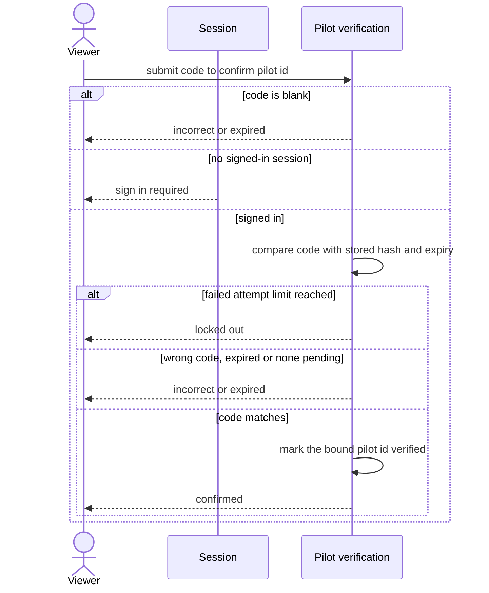

# Confirm pilot verification

A signed-in viewer enters the emailed code and the linked pilot id becomes verified.

## Code

| Element | Path |
|---|---|
| Viewer | src/features/account/actions.ts:100 |
| Session | src/lib/auth/current-user.ts |
| Pilot verification | src/lib/profiles/confirm-pilot-verification.ts, drizzle/0002_domain_functions.sql |
