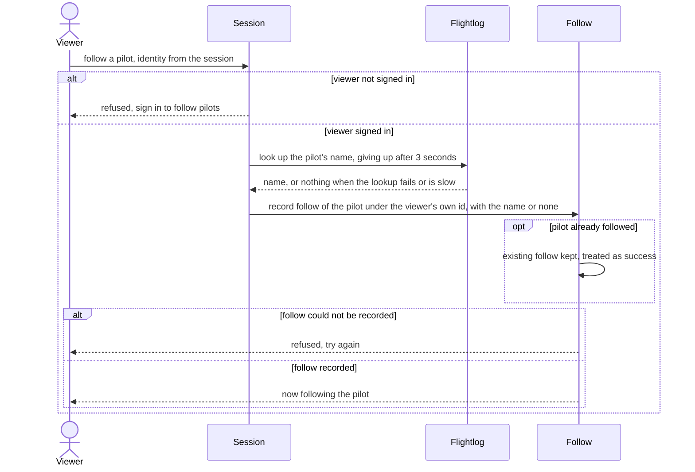

# Follow pilot

A signed-in viewer starts following a flightlog.org pilot.

## Code

| Element | Path |
|---|---|
| Viewer | src/components/follow-button/actions.ts:32 |
| Session | src/lib/auth/current-user.ts |
| Flightlog | src/components/follow-button/lookup-follow-name.ts |
| Follow | src/lib/follows/follow-pilot.ts |
