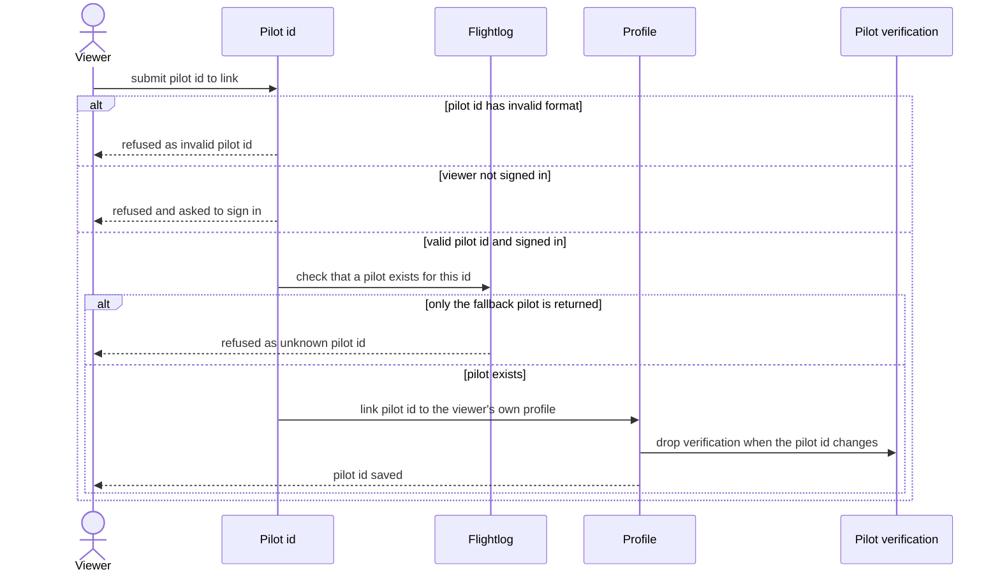

# Link pilot id

A signed-in viewer links their profile to a flightlog.org pilot id.

## Code

| Element | Path |
|---|---|
| Viewer | src/features/account/actions.ts:45 |
| Pilot id | src/lib/flightlog/types.ts:18 |
| Flightlog | src/lib/flightlog/is-fallback-pilot.ts |
| Profile | src/lib/profiles/update-flightlog-pilot-id.ts |
| Pilot verification | drizzle/0002_domain_functions.sql |
