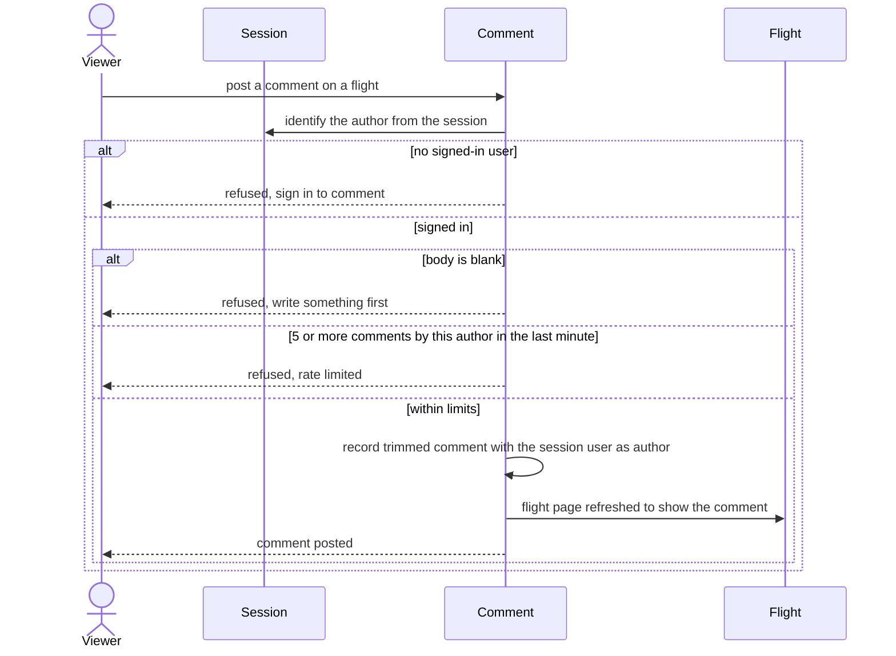

# Post comment

A signed-in viewer leaves a comment on a flight.

## Code

| Element | Path |
|---|---|
| Viewer | src/features/comment-on-flight/actions.ts:22 |
| Session | src/lib/auth/current-user.ts |
| Comment | src/lib/comments/post-comment.ts |
| Flight | src/lib/flightlog/types.ts |
