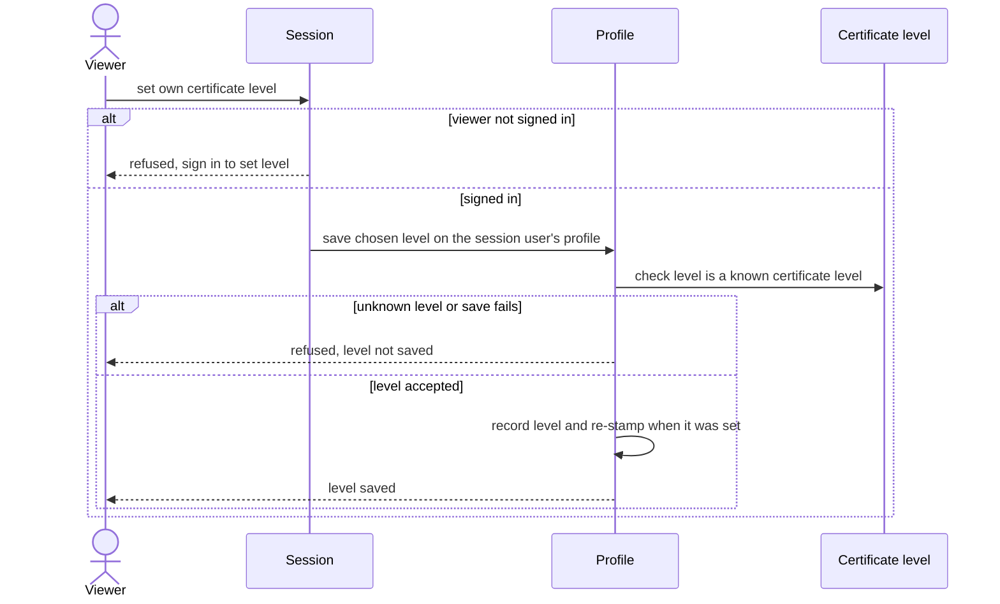

# Save certificate level

A signed-in viewer declares their own certificate level.

## Code

| Element | Path |
|---|---|
| Viewer | src/features/browse-pilot-certificate/actions.ts:17 |
| Session | src/lib/auth/current-user.ts |
| Profile | src/lib/profiles/update-certificate-level.ts |
| Certificate level | src/lib/db/domain-schema.ts:69 |
