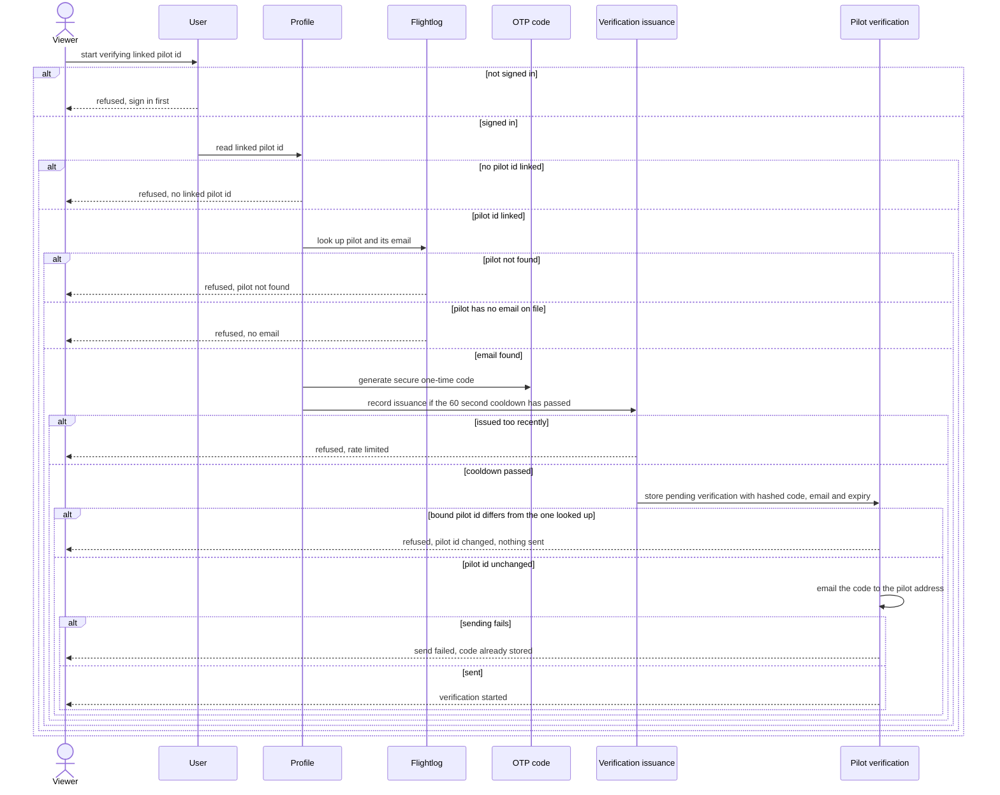

# Start pilot verification

A signed-in viewer asks for a code, emailed to the linked pilot's flightlog.org address, to prove they own the pilot id.

## Code

| Element | Path |
|---|---|
| Viewer | src/features/account/actions.ts:68 |
| User | src/lib/auth/current-user.ts |
| Profile | src/lib/profiles/get-profile.ts |
| Flightlog | src/lib/flightlog/get-pilot-email.ts |
| OTP code | src/lib/profiles/generate-otp-code.ts |
| Verification issuance | drizzle/0002_domain_functions.sql |
| Pilot verification | src/lib/profiles/issue-pilot-verification.ts, src/lib/email/send-verification-email.ts |
